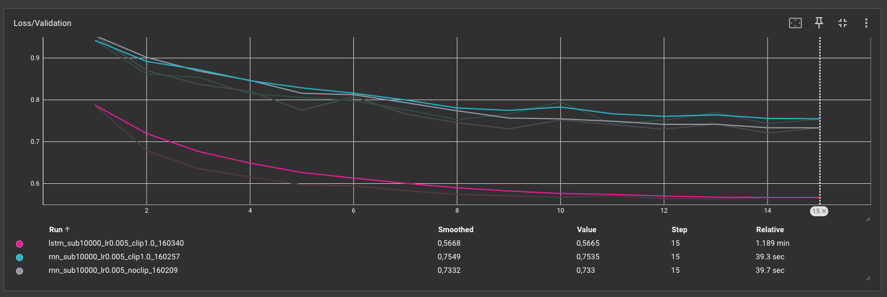
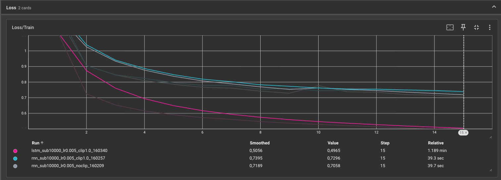
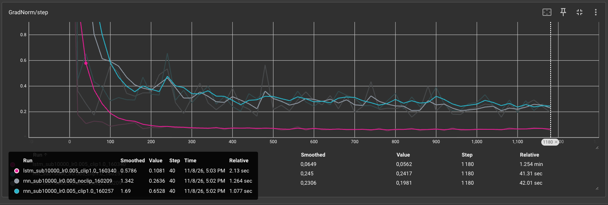

# TP4 : Réseaux récurrents et génération de séquences
## Exercice 1
### Q1. Chargement et découverte du jeu de données

Après exécution de `train_music.py`, on obtient :
- **Train :** 214 122 partitions
- **Validation :** 2 162 partitions

Voici la première partition du jeu d'entraînement :

```text
X:1
L:1/8
M:4/4
K:Emin
|: E2 EF E2 EF | DEFG AFDF | E2 EF E2 B2 |1 efe^d e2 e2 :|2 efe^d e3 B |: e2 ef g2 fe |
defg afdf |1 e2 ef g2 fe | efe^d e3 B :|2 g2 bg f2 af | efe^d e2 e2 ||
```

En regardant les premières lignes, on retrouve les informations suivantes :

- `X:1` : numéro de la partition.
- `L:1/8` : durée par défaut des notes 
- `M:4/4` : mesure à 4 temps.
- `K:Emin` : tonalité de mi mineur.

Ensuite, les lettres représentent les notes, les chiffres indiquent leur durée et les symboles `|` séparent les mesures. Les symboles `|:` et `:|` indiquent les reprises.
### Q2. Construction du vocabulaire et Padding

**1. Statistiques**

Après exécution du code, on obtient :
- Taille du vocabulaire : 95 caractères uniques
- Longueur moyenne : 290,1 caractères
- Longueur maximale : 2968 caractères

**2. Pourquoi utiliser `sorted()` ?**

On utilise `sorted()` pour avoir toujours le même ordre des caractères et donc les mêmes indices. Sans ça, les indices pourraient changer entre deux exécutions. Si on recharge un modèle déjà entraîné, il risque de ne plus associer les bons caractères aux bons indices, ce qui fausserait la génération.

**3. Pourquoi choisir `SEQ_LENGTH = 500` ?**

On choisit 500 plutôt que 2968 pour éviter d'ajouter trop de padding, sachant que la longueur moyenne est de 290 caractères. Avec 2968, on aurait beaucoup d'espaces inutiles, ce qui augmenterait le temps d'entraînement et l'utilisation de la mémoire GPU.
### Exercice 2 — Dataset PyTorch et modélisation

#### Q1. MusicDataset

Avec `SEQ_LENGTH = 500` et `BATCH_SIZE = 128`, les tenseurs `x` et `y` ont tous les deux une dimension de **(128, 499)**.

On utilise `torch.long` car les caractères sont représentés par des indices entiers qui seront utilisés par la couche `nn.Embedding`. Le type `float32` ne convient pas pour indexer cette couche.
#### Q2. Architecture RNN et LSTM

**1. Calcul du nombre de paramètres**

Pour `vocab_size = 95`, `embedding_dim = 256` et `hidden_size = 512` :

**Embedding :**

\[
95 \times 256 = 24\,320
\]

**RNN :**

\[
512 \times 256 + 512 \times 512 + 2 \times 512
= 394\,240
\]

**LSTM :**

\[
4 \times (512 \times 256 + 512 \times 512 + 2 \times 512)
= 1\,576\,960
\]

**Couche linéaire :**

\[
512 \times 95 + 95 = 48\,735
\]

On obtient donc au total :
- RNN : **467 295 paramètres**
- LSTM : **1 650 015 paramètres**

Le LSTM possède 4 fois plus de paramètres dans sa couche récurrente car il utilise 4 portes (oubli, entrée, sortie et candidate), alors que le RNN classique n'effectue qu'un seul calcul d'état caché.

**2. Pourquoi utiliser `nn.Embedding` ?**

On utilise `nn.Embedding` pour représenter chaque caractère par un vecteur de valeurs apprises. Cela permet au modèle d'apprendre des représentations plus adaptées que de simples indices numériques.

**3. Différence entre les états cachés du RNN et du LSTM**

Le RNN retourne un seul état caché `h_n`, qui contient les informations retenues après le traitement de la séquence.

Le LSTM retourne un tuple `(h_n, c_n)` :
- `h_n` : état caché, qui représente les informations utilisées en sortie.
- `c_n` : état de cellule, qui permet de conserver des informations sur une plus longue durée.

Cela permet au LSTM de mieux gérer les dépendances à long terme 

## Exercice 3 : Entraînement, dynamique des gradients et comparaison RNN vs LSTM

### Q1. Manipulation des tenseurs

On utilise `logits.reshape(-1, vocab_size)` pour transformer les prédictions en un tenseur de dimensions `(batch_size × seq_len, vocab_size)`, car `CrossEntropyLoss` attend une prédiction pour chaque caractère.

De la même façon, `y.reshape(-1)` permet de mettre toutes les cibles dans un seul vecteur.

Le `-1` correspond donc au nombre total de caractères prédits dans le batch.

### Q2. Ordre des opérations

On applique `clip_grad_norm_` après `loss.backward()` car il faut d'abord calculer les gradients.

Il faut ensuite appliquer le clipping avant `optimizer.step()` pour limiter les gradients trop importants avant la mise à jour des poids.

Cela permet d'éviter le problème d'exploding gradient et de rendre l'entraînement plus stable.

### Q3. Analyse expérimentale
#### Courbes TensorBoard

**Loss de validation**



**Accuracy de validation**



**Norme des gradients**



**Comparaison du Run 1 (RNN sans clipping) et du Run 2 (RNN avec clipping)**

Les deux RNN obtiennent des résultats assez proches. À la dernière époque, le RNN sans clipping a une loss de validation de 0,7330 contre 0,7535 pour celui avec clipping.

Sur les courbes, on remarque que les normes des gradients sont plus élevées au début, puis diminuent progressivement. Le clipping permet de limiter les gradients lorsqu'ils deviennent trop importants et donc d'éviter le problème d'exploding gradient.

Dans ce cas, le clipping n'apporte pas vraiment d'amélioration visible, puisque le RNN sans clipping obtient même une loss légèrement meilleure.

**Comparaison du Run 2 (RNN avec clipping) et du Run 3 (LSTM avec clipping)**

Le LSTM donne de meilleurs résultats que le RNN classique. Sa loss de validation est de 0,5665 contre 0,7535 pour le RNN. Son accuracy atteint 81,74 % contre 76,54 %.

On remarque aussi que le LSTM converge plus rapidement et que sa loss diminue de manière plus régulière.

Cela s'explique par les portes du LSTM, qui permettent de mieux gérer les informations à conserver ou à oublier.

L'état mémoire est mis à jour selon l'équation :

\[
c_t = f_t \odot c_{t-1} + i_t \odot \tilde{c}_t
\]

La porte d'oubli \(f_t\) contrôle les informations conservées de l'état précédent, tandis que la porte d'entrée \(i_t\) contrôle les nouvelles informations ajoutées.

Cela permet au LSTM de mieux conserver les informations sur de longues séquences et de limiter le problème de vanishing gradient.

### Q4. Réflexion sur la métrique

L'accuracy de validation est artificiellement élevée car les partitions sont complétées avec des espaces jusqu'à 500 caractères.

Pour éviter de prendre en compte le padding dans la loss, on peut utiliser `ignore_index` dans `CrossEntropyLoss` :

```python
loss_fn = nn.CrossEntropyLoss(
    ignore_index=char_to_index[" "]
)
```

Cela permet d'ignorer les espaces lors du calcul de la loss. Cependant, cette solution ignore aussi les vrais espaces présents dans les partitions. Une meilleure solution serait d'utiliser un caractère spécial réservé au padding.

Il faudrait également exclure le padding du calcul de l'accuracy pour obtenir une métrique plus représentative des performances du modèle.