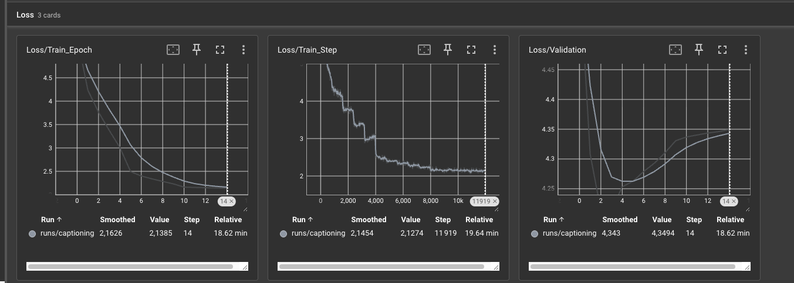
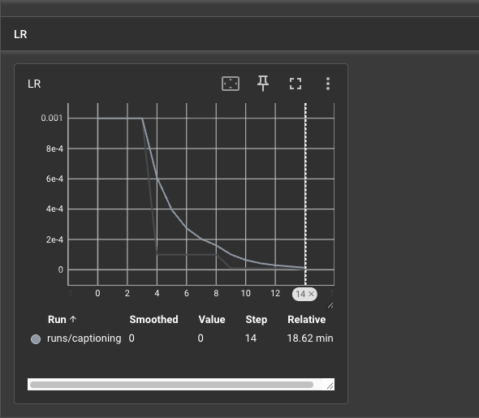

# TP5 : Image Captioning avec RNN et Attention sur ResNet
## Exercice 1
### Q1.a  
On redimensionne explicitement toutes les images à une taille fixe de (224, 224) avant de les passer dans le réseau pour pouvoir empiler les images en tenseurs batch (mini-batchs) et garantir des dimensions cohérentes sur la dernière carte de caractéristiques spatiales.
## Exercice 2
### Q1. 
On gele les poids du ResNet dans ce TP pour économiser la mémoire VRAM, et empêcher que les gradients bruités du début de l'entraînement ne détruisent les filtres visuels déjà appris.
### Q2.
Pour un tenseur d'entrée de forme `(32, 3, 224, 224)`, la sortie de `cnn_features` est :

**`(32, 2048, 7, 7)`**

Les deux dernières couches (`AdaptiveAvgPool2d` et `Linear`) ayant été supprimées, les dimensions spatiales sont conservées pour le mécanisme d'attention.

## Exercice 3
### Q3.a
Le `context_vector` est une représentation pondérée des caractéristiques visuelles de l'image, permettant au décodeur de se concentrer sur les régions les plus pertinentes à chaque étape de génération.

Il résout la limitation du Seq2Seq classique, qui compresse toute l'information dans un unique vecteur de taille fixe, en permettant un accès dynamique aux différentes régions de l'image grâce au mécanisme d'attention.
## Exercice 4
### 1. Entraînement

L'entraînement a été lancé sur le cluster Slurm avec un GPU NVIDIA L4, pendant 15 époques. Nous avons utilisé l'optimiseur Adam avec un learning rate initial de 0.001 et un scheduler StepLR. Les losses ont été suivies avec TensorBoard.

### 2. Comparaison des prédictions aux époques 1 et 10

**Époque 1 :**
> man men are standing are in the pool while other are in man in other man in in be

**Époque 10 :**
> man men are in underwater underwater pool pool while them one wearing one in other is in look be

On remarque qu'à l'époque 1, le modèle arrive déjà à identifier quelques éléments de l'image, comme les personnes et la piscine, mais la phrase n'est pas vraiment cohérente.

À l'époque 10, la prédiction est un peu plus pertinente avec l'apparition du mot « underwater ». Cependant, il y a encore beaucoup de répétitions et la syntaxe reste incorrecte.

Le modèle semble donc mieux apprendre certains éléments du contexte, mais la qualité des phrases ne s'améliore pas beaucoup.

### 3. Impact du scheduler StepLR

Le scheduler StepLR permet de diminuer progressivement le learning rate. Dans notre cas, il est divisé par 10 toutes les 5 époques : il passe de 0.001 à 0.0001, puis à 0.00001.

Si on gardait un learning rate constant à 0.001, les mises à jour des poids pourraient être trop importantes en fin d'entraînement. Le modèle risquerait alors d'osciller autour d'un minimum au lieu de converger plus précisément.

Même avec Adam, qui adapte le taux d'apprentissage pour chaque paramètre à partir des moments des gradients, réduire le learning rate global reste utile pour effectuer des ajustements plus petits en fin d'entraînement.

D'après nos courbes TensorBoard, la loss d'entraînement diminue de 5.37 à 2.14, mais la loss de validation commence à remonter après l'époque 3. On observe donc un surapprentissage, que la réduction du learning rate n'a pas suffi à éviter.

### Courbes TensorBoard

Les courbes suivantes montrent l'évolution des losses
d'entraînement et de validation au cours des 15 époques.

Le learning rate diminue toutes les 5 époques grâce au scheduler StepLR.

